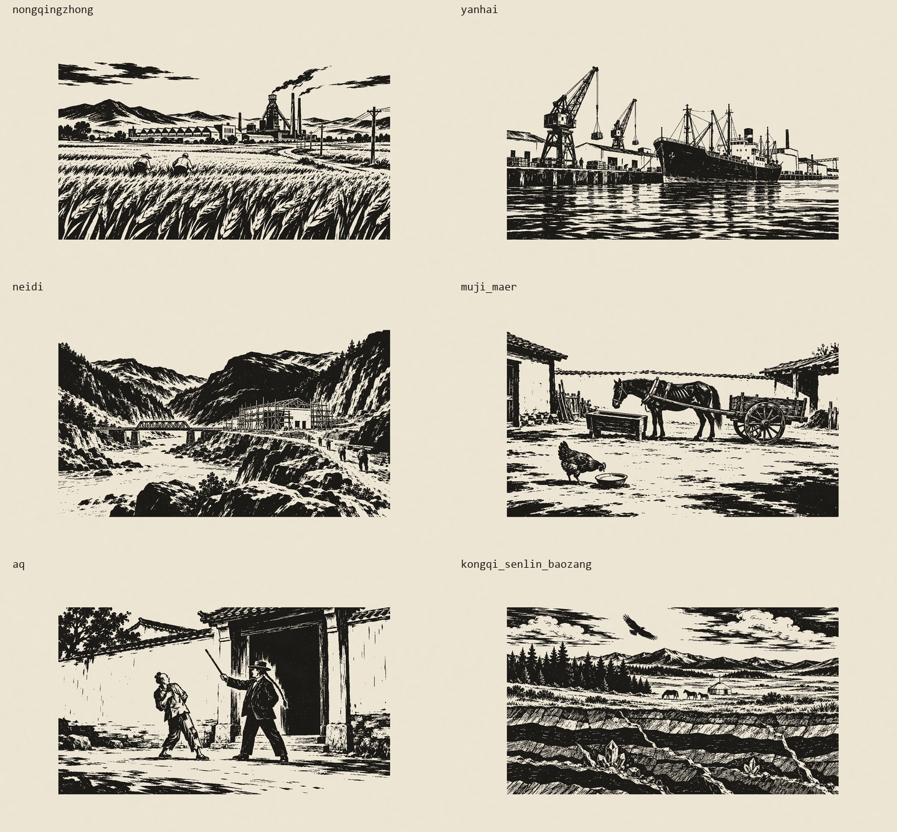
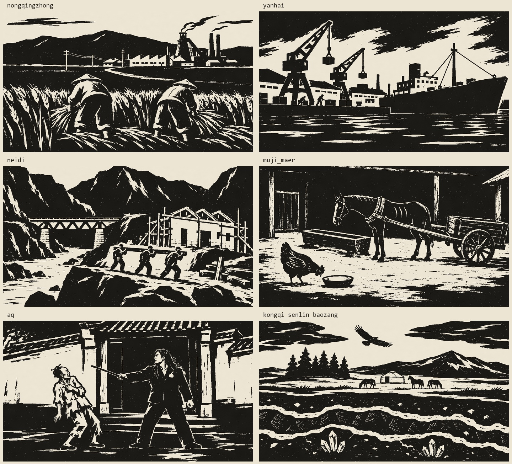

# 任务 D 木刻插图最终自审记录

日期：2026-10-20。**六组正式交付物目视自审及数值校验通过。**

## 依据与本轮修订

已完整阅读 [BRIEF.md](BRIEF.md) 与 [导演阐述](../../docs/导演阐述.md)。执行途中又发现本目录新增 [FEEDBACK_1.md](FEEDBACK_1.md)、[FEEDBACK_2.md](FEEDBACK_2.md)，因此撤回第三轮的暂选结论，继续返工。

反馈1要求粗刀、概括造型、减少细线，并以35%—50%实黑形成块面对照；六题全部重新生成。反馈2明确要求假洋鬼子“不要礼帽、不要绅士燕尾服”，改为乌黑洋衣、银桃子、披散头发，阿Q用竹筷盘辫。该较新的具体考据意见修订了原任务书的礼帽/假辫形象，最终版本以反馈2为准。本报告不将自审通过表述为导演已另行签批。

内置 **image_gen** 共成功生成并保留 **26张原图**：农轻重、内地、母鸡与马、资源剖面各4版；沿海与阿Q各5版。另有一次沿海v4调用连接失败，原提示词重试成功，不计作一张原图。所有成功版本原始PNG未改动，存于 `../../assets/img/raw/`；26条实际提示词及编辑输入均记录于本文件和 `generation.json`。

## 审核方法

1. 生成后逐张查看原图，比较结构、题意、刀法、伪文字与主体尺度。
2. 最终六张1920×1080纸底成品逐张查看；六张墨层的关键区域在白底上逐张放大查看。
3. 查看总览和各图中央70%裁切，检查图式统一、主体边界和裁切余量。
4. 程序逐像素核对尺寸、模式、墨色、Alpha、纸版色值范围；统计整张交付画布的实黑面积，连同纸边一起计算，不能以仅统计有墨版心夸大比例。
5. 独立执行两次后期，比较12个PNG的SHA-256；校验26个原图复制件与生成源文件一致。

| 题材 | 最终原图 | 整张画布实黑比例 | 目视 | 数值 |
|---|---|---:|---|---|
| 农、轻、重在同一片土地上 | nongqingzhong_v4.png | 36.05% | 通过 | 通过 |
| 沿海工业港口 | yanhai_v5.png | 38.04% | 通过 | 通过 |
| 内地新建工业 | neidi_v4.png | 37.12% | 通过 | 通过 |
| 母鸡与马 | muji_maer_v4.png | 39.96% | 通过 | 通过 |
| 阿Q：不准革命 | aq_v5.png | 39.25% | 通过 | 通过 |
| 空气、森林与地下宝藏 | kongqi_senlin_baozang_v4.png | 35.36% | 通过 | 通过 |

透明墨层为严格二值：RGB全为 `#1C1A17`，Alpha仅 `0/255`，无灰阶塑形。纸底版按要求加入极轻墨色浮动、漏白与纸纹，不能误称它只有两种RGB。数值检查不能证明艺术风格或形体正确；伪文字、刀法、肢体和题意由目视负责，未使用OCR冒充人工检查。





## 农、轻、重在同一片土地上 · `nongqingzhong`

| 版本 | 问题、修改与取舍 |
|---|---|
| v1 | 三层空间与三名收割者明确，但麦田细线过密，人物靠下，重工业部分偏右，未选。 |
| v2 | 改为两名农民，视野稍远；高炉仍靠右，麦田仍有细碎描画，未选。 |
| v3 | 第三轮曾暂选；最终因反馈1要求进一步强化黑块、简化远景而淘汰。两名农民明显缩小并以背影处理，宽刀麦穗、锯齿厂房、高炉和烟囱形成前中远景，小路与电线杆串起空间。大黑块与粗白刀口更统一。 |
| v4 | v4最终采用。远山简化成完整黑块，麦田用大刀口与成组麦穗，农民体态更有力量。锯齿厂房、高炉、两根烟囱仍在同一空间，小路与电线杆相连。 |

最终目视检查：农民为背影，手藏于收割麦束处，未见多余肢体；两个身形、倾斜与位置并非镜像。屋顶、烟和麦田均以粗刀口组织，未见伪文字。全图与中央70%裁切保留人物和主要厂房。

**结论：通过。** 实黑面积 36.05%，无中间Alpha。未见残留伪文字、明显畸形、柔光渐变或过度对称构图。

[全部版本对比](qa/nongqingzhong_versions.jpg) · [墨层局部](qa/nongqingzhong_detail.png) · [中央70%](qa/nongqingzhong_crop70.png) · [正式纸底图](../../assets/img/nongqingzhong_paper.png)

以下完整保留各版实际提示词。编辑版的输入为前一指定原图，原图未被覆写。

### nongqingzhong_v1

```text
Use case: historical-scene. Make one original Chinese New Woodcut Movement black-and-white relief print, landscape 16:9, ideally 2560x1440. This is a 1950s rural industrial book illustration, not a poster. Authentic hand-carved raised black forms on plain white: bold connected ink masses, assertive angular V-gouge marks, irregular U-gouge white hatch cuts, slightly rough cut edges, restrained honest observational composition. No grayscale shading, no gradients, no digital smooth curves, no photographic light, no blur, no speckled distress filter. No writing, lettering, numbers, signs, seals, signatures, borders or frames anywhere.
Subject: agriculture, light industry and heavy industry connected on the SAME land, in three receding spatial planes. In the foreground a wheat field with exactly three small Chinese farmers seen from the back harvesting, simply cut anatomy, hands largely hidden by wheat. Midground a textile mill unmistakably having a row of SAWTOOTH shed roofs, no windows shaped like text. In the distance a blast furnace and two chimneys, smoke made of flat white/black carved curving ribbons. A meandering field path and a few telegraph poles physically link all three planes. Keep the farmers, sawtooth mill, furnace and chimney tops inside the central 70 percent width AND height; outer 15 percent margins are expendable wheat/ground/sky. Modest landscape, asymmetric placement, quiet human labor. Large white sky, substantial black earth and mill silhouettes; tonal feeling only by purposeful carved hatch spacing. Pure BLACK ink and WHITE background only, no cream paper. Complete single scene, not collage.
```

### nongqingzhong_v2

```text
Use case: historical-scene. One original horizontal 16:9 Chinese New Woodcut Movement book illustration in the spirit of mid-century 1950s Chinese relief printmaking. Black ink on plain white. Genuine confident hand-cut raised black forms, broad solid ink masses, irregular tapered white V-gouge cuts and rounded U-gouge hatching, blunt economical marks, wood-grain roughness within the carved marks only. Tonality comes exclusively from cut spacing. Humble believable lived-in scene, restrained asymmetric composition, not a poster and not a finely engraved banknote. NO grayscale shading, gradients, stippling, airbrush, photographic light, blur, shiny rendering, calligraphic swirls or smooth vector outlines. No text of any kind, signs, lettering, numbers, signatures, seals, labels, frames or panel divisions. Small simplified people in side/back view only, modest hands hidden where possible, clear natural anatomy. IMPORTANT framing: zoomed-out panorama; all story-essential subjects completely within middle 70% of canvas both horizontally and vertically (15% crop-safe scene margin on EACH side); outer ground/sky/background expendable. Single complete landscape scene, not collage. Aim 2560x1440. Scene: three industries rooted in one continuous Chinese rural landscape. Foreground wheat field with exactly TWO SMALL farmers harvesting, backs toward viewer, full bodies well above lower margin, faces and hands obscured by hats and wheat. Midground textile mill with unequivocal row of sawtooth roofs. Farther away a modest blast furnace and two chimneys (keep chimney tops low enough for cropping), carved ribbon smoke. Winding field path and a few telegraph poles link the farm, mill and ironworks. Make wheat in broad grouped carved clumps, NOT countless fussy marks. Farmer group lies in lower middle-left, mill in center, ironworks behind to right, asymmetrical but visually balanced. Large calm white sky. Stronger and coarser gouge cuts, simpler than fine pen drawing.
```

### nongqingzhong_v3

```text
中国1950年代新兴木刻黑白阳刻插图，古元、彦涵、力群的朴素而有力的手工刀法气质。横幅16:9，单幅完整风景。请像木板上真正用三角刀和圆口刀一刀一刀刻成：概括大黑块、宽而短的不规则留白刀痕，少刻细节，绝非照片转素描、精密铜版画或钢笔速写。不加纸纹，不加灰色，只有纯黑纯白。绝无任何汉字、字母、数字、招牌、签名、印章。远景画法：麦田占前景，中间偏左两个小小的农民背影在收割，身体只高约画面12%，手藏在麦穗后；中景中央一排很明确的锯齿形屋顶纺织厂；远景中央偏右是一座高炉和两根烟囱，简练刀刻曲线作烟。小路和电线杆把三者联系在同一土地上。高炉必须放在横向65%处，绝不能挤到右边缘。把两个农民、整个纺织厂、整个高炉和烟囱都放进横向20%-80%、纵向20%-80%的中心区域。四边仅留麦田、远山和白天空作裁切余地。自然不对称，无装饰边框。主题是农轻重相互支持，有生活的质朴力量。
```

### nongqingzhong_v4

```text
Create an ORIGINAL BOLD CHINESE WOODBLOCK RELIEF PRINT, 1950s Chinese New Woodcut Movement, Gu Yuan / Li Hua spirit. Horizontal 16:9. CRITICAL: extremely simplified, almost naive carving, not realistic illustration. Think of a BLACK WOODBLOCK carved with a few large WHITE WEDGES. About 65% of the whole picture is connected SOLID BLACK INK, with broad clean WHITE paper shapes. Heavy flat silhouettes, blunt angular planes, thick tapering gouge marks, broken handcut edges. Only 20-40 prominent hatch gouges per large shape, no fine lines, no tiny photographic details, no stipple, NO engraving or pen drawing. Compress perspective, flatten depth, no lens or lighting effects. Pure black and pure white only. No text, letters, numbers, seals or signatures anywhere. Keep essential subjects in the middle 70% of width and height, all heads, feet and object extremities away from edges. Full scene extends to edges as expendable simple black ground, wall, water, or sky; no border. AGRICULTURE, LIGHT INDUSTRY, HEAVY INDUSTRY: two sturdy Chinese farmers in back view bent to harvest, each roughly one-quarter of image height, in central foreground. Their hats, jackets and trousers are simple BLACK SHAPES with only a few white gouges; hands mostly obscured. Wheat field is one broad BLACK foreground with a handful of forceful large WHITE stalk cuts, not hundreds of individual ears. Midground central small textile factory with a simple clearly sawtooth roof silhouette. Behind it, a small blast furnace and two squat chimneys to right of center, smoke as a couple white cuts. A single white path and three simple telegraph poles join all three. Distant hill is one flat black shape with two gouges. Modest simplified handmade scene, solid black occupies at least 60% of full image, white sky limited to upper quarter. Entire farmworkers and all three industrial silhouettes within central 70%.
```

## 沿海工业港口 · `yanhai`

| 版本 | 问题、修改与取舍 |
|---|---|
| v1 | 货轮和吊车清楚，但近景船首较大，右边仓库延伸过长，纹理细，未选。 |
| v2 | 船和两台吊车位置更平衡，作为可用对照；海面仍偏细密，后续以第三版更强的黑白块面统一全套。 |
| v3 | 第三轮曾暂选；最终因反馈1要求进一步强化黑块、简化远景而淘汰。大小不同的两架吊车与中央偏右的货轮形成不对称构图，船壳为大黑块，海面为较宽的水平刀纹；仓库、厂房及极小工人可辨。 |
| v4—v5 | v4重新生成粗刀大黑块，货轮、吊车和水面大幅简化，但船首出现类似字母U的白色记号，未放行。v5以v4为编辑输入，仅去除该记号后最终采用。 |

最终目视检查：船首放大确认无记号，仓库、船身和吊车没有字样。两架吊车和两名小工人的轮廓完整；桅杆和吊索保留，海面使用宽横刀纹。中央70%裁切货轮船首未被切掉。

**结论：通过。** 实黑面积 38.04%，无中间Alpha。未见残留伪文字、明显畸形、柔光渐变或过度对称构图。

[全部版本对比](qa/yanhai_versions.jpg) · [墨层局部](qa/yanhai_detail.png) · [中央70%](qa/yanhai_crop70.png) · [正式纸底图](../../assets/img/yanhai_paper.png)

以下完整保留各版实际提示词。编辑版的输入为前一指定原图，原图未被覆写。

### yanhai_v1

```text
Use case: historical-scene. One original horizontal 16:9 Chinese New Woodcut Movement book illustration in the spirit of mid-century 1950s Chinese relief printmaking. Black ink on plain white. Genuine confident hand-cut raised black forms, broad solid ink masses, irregular tapered white V-gouge cuts and rounded U-gouge hatching, blunt economical marks, wood-grain roughness within the carved marks only. Tonality comes exclusively from cut spacing. Humble believable lived-in scene, restrained asymmetric composition, not a poster and not a finely engraved banknote. NO grayscale shading, gradients, stippling, airbrush, photographic light, blur, shiny rendering, calligraphic swirls or smooth vector outlines. No text of any kind, signs, lettering, numbers, signatures, seals, labels, frames or panel divisions. Small simplified people in side/back view only, modest hands hidden where possible, clear natural anatomy. IMPORTANT framing: zoomed-out panorama; all story-essential subjects completely within middle 70% of canvas both horizontally and vertically (15% crop-safe scene margin on EACH side); outer ground/sky/background expendable. Single complete landscape scene, not collage. Aim 2560x1440. 1950s Chinese coastal industrial harbor. One cargo steamship in three-quarter side view at a dock, two characteristic lattice dock cranes with cables reaching their cargo, simple warehouses and sawtooth industrial workshops behind. No modern containers or cruise ships. A few tiny dockworkers. Sea in the foreground is unmistakably carved with broad HORIZONTAL black-and-white gouge strokes, irregular spacing, white wakes. Ship, cranes, warehouses occupy the middle width, all crane tops safely below 15% top margin. Calm documentary observation, broad black ship hull, white water, angular industrial silhouettes, not a dramatic epic scene.
```

### yanhai_v2

```text
Use case: historical-scene. One original horizontal 16:9 Chinese New Woodcut Movement book illustration in the spirit of mid-century 1950s Chinese relief printmaking. Black ink on plain white. Genuine confident hand-cut raised black forms, broad solid ink masses, irregular tapered white V-gouge cuts and rounded U-gouge hatching, blunt economical marks, wood-grain roughness within the carved marks only. Tonality comes exclusively from cut spacing. Humble believable lived-in scene, restrained asymmetric composition, not a poster and not a finely engraved banknote. NO grayscale shading, gradients, stippling, airbrush, photographic light, blur, shiny rendering, calligraphic swirls or smooth vector outlines. No text of any kind, signs, lettering, numbers, signatures, seals, labels, frames or panel divisions. Small simplified people in side/back view only, modest hands hidden where possible, clear natural anatomy. IMPORTANT framing: zoomed-out panorama; all story-essential subjects completely within middle 70% of canvas both horizontally and vertically (15% crop-safe scene margin on EACH side); outer ground/sky/background expendable. Single complete landscape scene, not collage. Aim 2560x1440. An unheroic working coastal industrial port in China in the 1950s, seen across a generous stretch of calm water. Cargo steamer with black hull sits diagonally just right of center; two sturdy lattice dockside cranes grouped to the left, low warehouses and plain factory sheds behind. One crane hoists a plain crate above quay, not above people. Tiny laborers are simple cut silhouettes. Thick level horizontal sea cuts, large white sky. Keep the entire vessel, crane tips and all main buildings in the central 70%, allowing sea/blank sky/low land at all edges. Dense black shapes and broad economical rough white gouges, less fine technical detail, human-scale practical industry. No signage on ship or buildings.
```

### yanhai_v3

```text
中国1950年代新兴木刻黑白阳刻书籍插图，参照古元、彦涵、李桦、力群、赵延年的质朴刀法气质。横幅16:9，一幅完整画面。像木板用三角刀和圆口刀真正手刻：概括厚实大黑块，宽、短、不规则的留白刀痕，疏密有节制，少刻细节。不是照片转素描、精密铜版、钢笔线描、电脑矢量图。纯黑纯白，不加纸纹，无灰色灰阶渐变、无柔光。画面绝无文字、数字、招牌、签名、印章，建筑只画空白墙面。视野拉远，所有重要物件集中在横向20%-80%、纵向20%-80%的区域，四边只留可裁切的环境。自然不对称，无边框。题材为1950年代沿海工业港口。一艘朴素老式货轮停靠码头，货轮完整位于中央偏右，左边两架大小不同的码头吊车，后方是仓库和厂房。货轮高约画面25%，两台吊车顶部在画面纵向20%以下，船和吊车不可挤出中间70%。船身大块黑，海面使用有力的横向刀纹，宽窄不齐而平静，不刻密密麻麻的小波纹；吊车桁架简练但结构通顺。两三个极小的工人是侧影或背影，手不刻细节。不画现代集装箱，不画轮船名字。大白天空、简洁朴素、工业日常。
```

### yanhai_v4

```text
Create an ORIGINAL BOLD CHINESE WOODBLOCK RELIEF PRINT, 1950s Chinese New Woodcut Movement, Gu Yuan / Li Hua spirit. Horizontal 16:9. CRITICAL: extremely simplified, almost naive carving, not realistic illustration. Think of a BLACK WOODBLOCK carved with a few large WHITE WEDGES. About 65% of the whole picture is connected SOLID BLACK INK, with broad clean WHITE paper shapes. Heavy flat silhouettes, blunt angular planes, thick tapering gouge marks, broken handcut edges. Only 20-40 prominent hatch gouges per large shape, no fine lines, no tiny photographic details, no stipple, NO engraving or pen drawing. Compress perspective, flatten depth, no lens or lighting effects. Pure black and pure white only. No text, letters, numbers, seals or signatures anywhere. Keep essential subjects in the middle 70% of width and height, all heads, feet and object extremities away from edges. Full scene extends to edges as expendable simple black ground, wall, water, or sky; no border. 1950s Chinese industrial port in a very coarse carved print. One modest cargo steamer at center-right is a huge simple BLACK hull silhouette; simplify the deck to a few blocky shapes and ONE mast with two thick ropes. TWO dockside cranes at center-left are sturdy simple silhouettes, only 3 or 4 cutout triangles in each boom, structurally readable, no technical line web. Behind: warehouse and factory as low black and white rectangles. Two TINY robust dockworkers, almost featureless side silhouettes. Foreground sea is BLACK, with only a few broad horizontal WHITE cuts of different widths. At least 60% whole image solid black, not outlined objects on white. Keep both crane tops, the whole ship and small workers within central 70% of frame. No text on hull, no signs. Atmospheric drama comes ONLY from black-white masses, not gradients. Coarse unpolished local craftsman carving, limited detail.
```

### yanhai_v5

编辑输入：`assets/img/raw/yanhai_v4.png`。

```text
Use case: precise-object-edit. Edit the provided harbor woodcut. Make ONE correction only: completely remove the small WHITE U-shaped mark on the upper right part of the black ship hull near the bow. Fill that little area with matching solid black hull ink, with no symbol or lettering remaining. Preserve absolutely all other objects, the composition, full canvas, two cranes, workers, white sea cuts, black sky, ship and coarse handmade gouge edges unchanged. No added text, numbers, symbols, gray gradients, signature or border.
```

## 内地新建工业 · `neidi`

| 版本 | 问题、修改与取舍 |
|---|---|
| v1 | 铁路桥与工地关系可读，但厂房过大、偏右，山体细碎，未选。 |
| v2 | 桥的桁架清楚，但额外出现火车，厂房仍贴边，工地较繁杂，未选。 |
| v3 | 第三轮曾暂选；最终因反馈1要求进一步强化黑块、简化远景而淘汰。拉远到山谷尺度，桥、河、未竣工厂房和抬木料工人同处一个空间；山的黑块更扎实，屋架与脚手架能分辨。 |
| v4 | v4最终采用。山体改为大黑块与少数楔形白刀，桥梁和厂房结构概括，三名抬梁工人比前几版更有劳动力量。 |

最终目视检查：桥梁接至两岸，厂房有未完工屋架和清楚的脚手架。三人共抬长梁，肩、手与梁的位置可读，腿脚未见多余或错接。画面左移0.8%以保留右侧工地主体的裁切余量；主体框和裁切预览均通过。

**结论：通过。** 实黑面积 37.12%，无中间Alpha。未见残留伪文字、明显畸形、柔光渐变或过度对称构图。

[全部版本对比](qa/neidi_versions.jpg) · [墨层局部](qa/neidi_detail.png) · [中央70%](qa/neidi_crop70.png) · [正式纸底图](../../assets/img/neidi_paper.png)

以下完整保留各版实际提示词。编辑版的输入为前一指定原图，原图未被覆写。

### neidi_v1

```text
Use case: historical-scene. One original horizontal 16:9 Chinese New Woodcut Movement book illustration in the spirit of mid-century 1950s Chinese relief printmaking. Black ink on plain white. Genuine confident hand-cut raised black forms, broad solid ink masses, irregular tapered white V-gouge cuts and rounded U-gouge hatching, blunt economical marks, wood-grain roughness within the carved marks only. Tonality comes exclusively from cut spacing. Humble believable lived-in scene, restrained asymmetric composition, not a poster and not a finely engraved banknote. NO grayscale shading, gradients, stippling, airbrush, photographic light, blur, shiny rendering, calligraphic swirls or smooth vector outlines. No text of any kind, signs, lettering, numbers, signatures, seals, labels, frames or panel divisions. Small simplified people in side/back view only, modest hands hidden where possible, clear natural anatomy. IMPORTANT framing: zoomed-out panorama; all story-essential subjects completely within middle 70% of canvas both horizontally and vertically (15% crop-safe scene margin on EACH side); outer ground/sky/background expendable. Single complete landscape scene, not collage. Aim 2560x1440. New inland industry in 1950s China. Within a valley among solid rugged mountains, a convincing RAILWAY BRIDGE with parallel rails crosses a winding river gorge left of center. On the near right bank is ONE new factory building under construction, exposed roof trusses and an orderly but handbuilt timber scaffold attached around its walls, distinct from the bridge. Four tiny workers carry a beam and work at ground level. Mountain planes shown with grouped angular white gouge cuts in large black shapes. River shown by white channel and sparse lateral cuts. Cohesive real landscape, bridge connected to track on BOTH banks, structural clarity, no fantasy architecture. Wide quiet surroundings, all story objects in central 70%.
```

### neidi_v2

```text
Use case: historical-scene. One original horizontal 16:9 Chinese New Woodcut Movement book illustration in the spirit of mid-century 1950s Chinese relief printmaking. Black ink on plain white. Genuine confident hand-cut raised black forms, broad solid ink masses, irregular tapered white V-gouge cuts and rounded U-gouge hatching, blunt economical marks, wood-grain roughness within the carved marks only. Tonality comes exclusively from cut spacing. Humble believable lived-in scene, restrained asymmetric composition, not a poster and not a finely engraved banknote. NO grayscale shading, gradients, stippling, airbrush, photographic light, blur, shiny rendering, calligraphic swirls or smooth vector outlines. No text of any kind, signs, lettering, numbers, signatures, seals, labels, frames or panel divisions. Small simplified people in side/back view only, modest hands hidden where possible, clear natural anatomy. IMPORTANT framing: zoomed-out panorama; all story-essential subjects completely within middle 70% of canvas both horizontally and vertically (15% crop-safe scene margin on EACH side); outer ground/sky/background expendable. Single complete landscape scene, not collage. Aim 2560x1440. Broad distant view of inland Chinese industrial construction in a mountain river valley, 1950s. A short sturdy railway truss bridge crosses the narrow ravine on the middle left, real two rails continue across it and onto both banks. To the right a single rectangular unfinished factory with clearly exposed timber scaffold on its outer wall, simple triangular roof trusses and unglazed window openings. A handful of very small workers carry timber and push one simple wheelbarrow along a site path. No oversized faces or hands. Surrounding dark mountain masses cut with forceful wide diagonal wedges, white river below bridge. All bridge, factory, workers clearly readable but safely away from all 15% crop edges. Very economical hand-carved bold black-and-white shapes, rather than fussy pictorial detail.
```

### neidi_v3

```text
中国1950年代新兴木刻黑白阳刻书籍插图，参照古元、彦涵、李桦、力群、赵延年的质朴刀法气质。横幅16:9，一幅完整画面。像木板用三角刀和圆口刀真正手刻：概括厚实大黑块，宽、短、不规则的留白刀痕，疏密有节制，少刻细节。不是照片转素描、精密铜版、钢笔线描、电脑矢量图。纯黑纯白，不加纸纹，无灰色灰阶渐变、无柔光。画面绝无文字、数字、招牌、签名、印章，建筑只画空白墙面。视野拉远，所有重要物件集中在横向20%-80%、纵向20%-80%的区域，四边只留可裁切的环境。自然不对称，无边框。题材为1950年代中国内地新建工业。群山中一个河谷，中央偏左有一座短而坚实的铁路桁架桥跨过河谷，两根钢轨衔接两岸；中央偏右是一座未完工的新厂房，清楚可辨的木脚手架围着墙壁，屋顶有部分裸露三角屋架。厂房和桥都远远看、小而完整，厂房最右端不得超过画面78%，厂房不超过画面宽28%，桥长约25%。几个小工人高不超过画面7%，背影抬木料，姿态简单自然。山的暗面是一整块黑，用少数大而硬朗的斜刀纹刻山石，河流留白，工地不铺满杂物。不画火车。把桥、厂房、工人安排在同一个有真实路径联系的山谷中。
```

### neidi_v4

```text
Create an ORIGINAL BOLD CHINESE WOODBLOCK RELIEF PRINT, 1950s Chinese New Woodcut Movement, Gu Yuan / Li Hua spirit. Horizontal 16:9. CRITICAL: extremely simplified, almost naive carving, not realistic illustration. Think of a BLACK WOODBLOCK carved with a few large WHITE WEDGES. About 65% of the whole picture is connected SOLID BLACK INK, with broad clean WHITE paper shapes. Heavy flat silhouettes, blunt angular planes, thick tapering gouge marks, broken handcut edges. Only 20-40 prominent hatch gouges per large shape, no fine lines, no tiny photographic details, no stipple, NO engraving or pen drawing. Compress perspective, flatten depth, no lens or lighting effects. Pure black and pure white only. No text, letters, numbers, seals or signatures anywhere. Keep essential subjects in the middle 70% of width and height, all heads, feet and object extremities away from edges. Full scene extends to edges as expendable simple black ground, wall, water, or sky; no border. Inland industrial construction in a Chinese mountain valley. Three great dark mountain masses in background and sides, VERY simple, each has just a handful of wide white angular cuts. Across central left gorge is a SHORT railway bridge: blunt black beams with 4 clear triangular openings, solid stone piers, two white rails connect both banks. Center-right is ONE small unfinished factory, simple rectangular white wall and black doorway, a few clear thick timber scaffold poles surrounding it and three roof trusses. Three stout small worker silhouettes carrying one simple timber beam on a site path, all within central 70%. Foreground rock is a mostly BLACK plane, river a WHITE winding strip. 65% picture solid black. No train. No intricate mountains, no crowds, no tiny foliage, no technical draftsmanship. Flattened rough handcarved perspective, few cuts, everyday labor.
```

## 母鸡与马 · `muji_maer`

| 版本 | 问题、修改与取舍 |
|---|---|
| v1 | 两个容器的空腔可读，但母鸡羽毛和马身纹理偏细，马车靠右，未选。 |
| v2 | 母鸡较小，仍有繁密墙纹和动物细线，马车依然靠边，未选。 |
| v3 | 第三轮曾暂选；最终因反馈1要求进一步强化黑块、简化远景而淘汰。母鸡低头对着空碗；后方瘦马套车，空槽置于嘴前。粗刀羽毛和少量肋骨比前两版更概括，空院地支持讽喻。 |
| v4 | v4最终采用。以黑色棚墙与白色院地对照，鸡羽只留少量刀口，马身仅用三条主要肋骨刻痕。空食碗、空槽及套车关系仍明确。 |

最终目视检查：检查鸡头、喙、两腿，马头、两耳、四腿、尾巴、套具与车辕；未见明显畸形或穿插。碗中无粮、槽中无草，槽的暗腔不误作饲料。画面左移0.8%，中央70%保留整个车尾和车轮。瘦马无伤口或夸张丑化。

**结论：通过。** 实黑面积 39.96%，无中间Alpha。未见残留伪文字、明显畸形、柔光渐变或过度对称构图。

[全部版本对比](qa/muji_maer_versions.jpg) · [墨层局部](qa/muji_maer_detail.png) · [中央70%](qa/muji_maer_crop70.png) · [正式纸底图](../../assets/img/muji_maer_paper.png)

以下完整保留各版实际提示词。编辑版的输入为前一指定原图，原图未被覆写。

### muji_maer_v1

```text
Use case: historical-scene. One original horizontal 16:9 Chinese New Woodcut Movement book illustration in the spirit of mid-century 1950s Chinese relief printmaking. Black ink on plain white. Genuine confident hand-cut raised black forms, broad solid ink masses, irregular tapered white V-gouge cuts and rounded U-gouge hatching, blunt economical marks, wood-grain roughness within the carved marks only. Tonality comes exclusively from cut spacing. Humble believable lived-in scene, restrained asymmetric composition, not a poster and not a finely engraved banknote. NO grayscale shading, gradients, stippling, airbrush, photographic light, blur, shiny rendering, calligraphic swirls or smooth vector outlines. No text of any kind, signs, lettering, numbers, signatures, seals, labels, frames or panel divisions. Small simplified people in side/back view only, modest hands hidden where possible, clear natural anatomy. IMPORTANT framing: zoomed-out panorama; all story-essential subjects completely within middle 70% of canvas both horizontally and vertically (15% crop-safe scene margin on EACH side); outer ground/sky/background expendable. Single complete landscape scene, not collage. Aim 2560x1440. A plain Chinese farm courtyard in the 1950s, quiet gently satirical scene about animals asked to produce without being fed. Foreground center-left ONE hen in natural SIDE view, lowered head and beak looking into a distinctly EMPTY shallow feeding bowl immediately before her. Bowl interior is exposed plain white, no grain. Behind and slightly right ONE lean but dignified horse in SIDE view, four anatomically clear legs, harnessed between two shafts to a plain two-wheeled farm cart behind it. A clearly EMPTY wooden feeding trough is just in front of the horse and does not obscure the horse's legs; clean blank interior, no hay. Horse modestly thin with a few rib cuts, never grotesque or suffering caricature. Hen, bowl, whole horse, cart, trough fully within middle 70% of image. Sparse mud wall and farm gate as background. The two visible empty containers carry the visual argument. Large quiet unmarked courtyard foreground; no extra animals or people.
```

### muji_maer_v2

```text
Use case: historical-scene. One original horizontal 16:9 Chinese New Woodcut Movement book illustration in the spirit of mid-century 1950s Chinese relief printmaking. Black ink on plain white. Genuine confident hand-cut raised black forms, broad solid ink masses, irregular tapered white V-gouge cuts and rounded U-gouge hatching, blunt economical marks, wood-grain roughness within the carved marks only. Tonality comes exclusively from cut spacing. Humble believable lived-in scene, restrained asymmetric composition, not a poster and not a finely engraved banknote. NO grayscale shading, gradients, stippling, airbrush, photographic light, blur, shiny rendering, calligraphic swirls or smooth vector outlines. No text of any kind, signs, lettering, numbers, signatures, seals, labels, frames or panel divisions. Small simplified people in side/back view only, modest hands hidden where possible, clear natural anatomy. IMPORTANT framing: zoomed-out panorama; all story-essential subjects completely within middle 70% of canvas both horizontally and vertically (15% crop-safe scene margin on EACH side); outer ground/sky/background expendable. Single complete landscape scene, not collage. Aim 2560x1440. A homely rural courtyard, wide unembellished observation. ONE little hen at center-left bows her head toward an EMPTY shallow food bowl; white hollow inside is plainly visible. Farther back, centered across middle of picture, ONE thin farm horse shown in simple clear profile facing left, neatly harnessed to a small two-wheeled wooden cart behind on right. Four coherent horse legs, two ears, one head, one tail; no overlapping second animal. An EMPTY wooden trough sits in front of the horse at the far side of its muzzle, not covering legs, clearly open white cavity, absolutely no hay. Restrained visible ribs made with only a few gouge marks. Mild social irony from both empty vessels, not cruelty or cartoon comedy. Mud wall and low tiled shed loosely cut in background; quiet yard and sky are expendable 15% margins all around. All essential animals, harness, cart and bowls inside middle 70%. Forceful simple black masses, broad irregular carved white cuts, no stippled aged-paper effect.
```

### muji_maer_v3

```text
中国1950年代新兴木刻黑白阳刻书籍插图，参照古元、彦涵、李桦、力群、赵延年的质朴刀法气质。横幅16:9，一幅完整画面。像木板用三角刀和圆口刀真正手刻：概括厚实大黑块，宽、短、不规则的留白刀痕，疏密有节制，少刻细节。不是照片转素描、精密铜版、钢笔线描、电脑矢量图。纯黑纯白，不加纸纹，无灰色灰阶渐变、无柔光。画面绝无文字、数字、招牌、签名、印章，建筑只画空白墙面。视野拉远，所有重要物件集中在横向20%-80%、纵向20%-80%的区域，四边只留可裁切的环境。自然不对称，无边框。一座朴素农家院子的远景。中间偏左一只小母鸡低头看着前方空空的食碗，母鸡高度只占画面15%，食碗是清楚的白色空腔，没有一粒粮。后面中央一匹瘦而不丑化的马，四条腿、两个耳朵、一个头和一条尾巴都简洁自然，侧面、全身。马套着一辆简单两轮木车，马加车的完整长度不超过画面宽55%，整个车轮和车尾都在横向80%以内。马前方有一个空马槽，开口白、完全无草料，不遮挡马腿。肋骨只刻三四条、不要恐怖。母鸡、空碗、马、空槽、马车都安排在中央区域，四边给充足空院地与白天色。背景只有一段矮院墙和低小瓦棚，不画繁密砖石和树叶。用粗略宽刀表现羽毛和马鬃，动物形象要概括，不画摄影式丝丝毛发。略含讽意但不做滑稽漫画。
```

### muji_maer_v4

```text
Create an ORIGINAL BOLD CHINESE WOODBLOCK RELIEF PRINT, 1950s Chinese New Woodcut Movement, Gu Yuan / Li Hua spirit. Horizontal 16:9. CRITICAL: extremely simplified, almost naive carving, not realistic illustration. Think of a BLACK WOODBLOCK carved with a few large WHITE WEDGES. About 65% of the whole picture is connected SOLID BLACK INK, with broad clean WHITE paper shapes. Heavy flat silhouettes, blunt angular planes, thick tapering gouge marks, broken handcut edges. Only 20-40 prominent hatch gouges per large shape, no fine lines, no tiny photographic details, no stipple, NO engraving or pen drawing. Compress perspective, flatten depth, no lens or lighting effects. Pure black and pure white only. No text, letters, numbers, seals or signatures anywhere. Keep essential subjects in the middle 70% of width and height, all heads, feet and object extremities away from edges. Full scene extends to edges as expendable simple black ground, wall, water, or sky; no border. A sparse Chinese farm courtyard. ONE hen bows toward an EMPTY shallow bowl in central foreground left. Hen is a simple robust black shape with just 5-8 thick white feather cuts, not realistic feather detail; two normal legs. Bowl is empty white interior with black rim. Behind at center ONE thin but dignified horse stands in side profile, four natural legs, no anatomical grotesquerie; body a connected black silhouette with only THREE broad rib cuts. Horse harnessed with two simple shafts to a small two-wheel wooden cart, all inside central 70%. In front of the horse an EMPTY feed trough, clear open unfilled cavity, no hay. Courtyard background mostly a deep BLACK shed wall contrasting a WHITE ground opening; omit bricks, tree foliage and elaborate roof details. Ground edges substantial black shapes with sparse white gouges. At least 60% solid black across image. Mild social satire by two empty vessels, not a comic animal caricature. Very coarse naive economical relief print.
```

## 阿Q：不准革命 · `aq`

| 版本 | 问题、修改与取舍 |
|---|---|
| v1 | 阻拦和退缩关系成立，但人物过大、衣褶过细；阿Q发髻位置与顶盘辫特征不够突出，未选。 |
| v2 | 拉远后发式、礼帽和长辫清楚，但阿Q躯干偏向前，退缩动作不如第三版直接，未选。 |
| v3 | 第三轮曾暂选；最终因反馈1要求进一步强化黑块、简化远景而淘汰。右侧假洋鬼子穿西服戴礼帽，脑后长假辫，扬起细棒；左侧阿Q剃前额、顶上盘辫、短破衣，躯干向后缩退。用门洞黑影与白墙组织画面。 |
| v4—v5 | v4按反馈2重做无礼帽、散发、银桃子与竹筷盘辫，但假洋鬼子被生成为浓须老人，银佩形状也偏葫芦。v5保留两人姿态与构图，只修正右侧人物的头部和银桃子，最终采用。 |

最终目视检查：假洋鬼子无礼帽、无燕尾服，穿乌黑洋衣，头发散落肩背，胸前白色桃形银佩无字；持棒阻拦。阿Q剃前额、盘辫上有竹筷，破夹袄、瘦小，身体向后缩。两人手脚及持棒关系可读，未见明显畸形；墙门无文字。中央70%保留两人全身和棍子。

**结论：通过。** 实黑面积 39.25%，无中间Alpha。未见残留伪文字、明显畸形、柔光渐变或过度对称构图。

[全部版本对比](qa/aq_versions.jpg) · [墨层局部](qa/aq_detail.png) · [中央70%](qa/aq_crop70.png) · [正式纸底图](../../assets/img/aq_paper.png)

以下完整保留各版实际提示词。编辑版的输入为前一指定原图，原图未被覆写。

### aq_v1

```text
Use case: historical-scene. One original horizontal 16:9 Chinese New Woodcut Movement book illustration in the spirit of mid-century 1950s Chinese relief printmaking. Black ink on plain white. Genuine confident hand-cut raised black forms, broad solid ink masses, irregular tapered white V-gouge cuts and rounded U-gouge hatching, blunt economical marks, wood-grain roughness within the carved marks only. Tonality comes exclusively from cut spacing. Humble believable lived-in scene, restrained asymmetric composition, not a poster and not a finely engraved banknote. NO grayscale shading, gradients, stippling, airbrush, photographic light, blur, shiny rendering, calligraphic swirls or smooth vector outlines. No text of any kind, signs, lettering, numbers, signatures, seals, labels, frames or panel divisions. Small simplified people in side/back view only, modest hands hidden where possible, clear natural anatomy. IMPORTANT framing: zoomed-out panorama; all story-essential subjects completely within middle 70% of canvas both horizontally and vertically (15% crop-safe scene margin on EACH side); outer ground/sky/background expendable. Single complete landscape scene, not collage. Aim 2560x1440. Illustrate the exclusion scene from Lu Xun's The True Story of Ah Q, early 20th-century China, at the entrance of a prosperous Qian family compound. NO plaque or couplet or writing. Two modest-sized full figures mainly in PROFILE, entire figures in central 70%. On left at doorway, the fake foreign devil wears a WESTERN SUIT with lapels and a TOP HAT; from behind the hat at his NAPE visibly hangs a long thin FALSE QUEUE braid. He blocks the path, leaning forward and raises a plain slender wooden cane diagonally in one hand threateningly, other hand simple and partly obscured. On right, Ah Q recoils backward, shoulders hunched, weight leaning away, one foot retreating, wearing ragged SHORT traditional jacket and loose trousers. Ah Q has a distinctly SHAVED FRONT SCALP and a small BRAID COILED ON THE CROWN of his head, no hat. Fear/exclusion expressed through whole-body stance, not closeup faces. No contact, no injury. Simple empty white gap between the two separates silhouettes. Weathered gate, wall, plain stone threshold; no decorative motifs that look like text. Humble rough woodcut theatre of posture, anatomically simple readable hands and feet.
```

### aq_v2

```text
Use case: historical-scene. One original horizontal 16:9 Chinese New Woodcut Movement book illustration in the spirit of mid-century 1950s Chinese relief printmaking. Black ink on plain white. Genuine confident hand-cut raised black forms, broad solid ink masses, irregular tapered white V-gouge cuts and rounded U-gouge hatching, blunt economical marks, wood-grain roughness within the carved marks only. Tonality comes exclusively from cut spacing. Humble believable lived-in scene, restrained asymmetric composition, not a poster and not a finely engraved banknote. NO grayscale shading, gradients, stippling, airbrush, photographic light, blur, shiny rendering, calligraphic swirls or smooth vector outlines. No text of any kind, signs, lettering, numbers, signatures, seals, labels, frames or panel divisions. Small simplified people in side/back view only, modest hands hidden where possible, clear natural anatomy. IMPORTANT framing: zoomed-out panorama; all story-essential subjects completely within middle 70% of canvas both horizontally and vertically (15% crop-safe scene margin on EACH side); outer ground/sky/background expendable. Single complete landscape scene, not collage. Aim 2560x1440. A spare 1950s hand-carved book illustration of the 'forbidden to join the revolution' incident in Lu Xun's Ah Q. Early republican Chinese wealthy Qian household gate, blank wall and plain doorway, NO signs or writing. On the right the fake foreign devil guards the doorway in WESTERN SUIT, buttoned coat with lapels, TOP HAT, visible long FALSE BRAID hanging from the NAPE behind his head. He raises one thin wooden cane diagonally above his shoulder, an assertive forbidding posture. Left of him Ah Q recoils a step backward, hunched and shrinking, seen in profile: SHAVED FOREHEAD, his own braid COILED like a small knot on top of his bare crown, ragged SHORT JACKET with uneven hem and loose trousers. Both figures small to medium, fully seen, total group plus doorway safely inside middle 70% of canvas with generous bare courtyard at bottom. Clear separation between hands/cane/braid, no merged limbs. Express relation through asymmetrical poses and the white space between figures. Black clothes and wall shadows contrast with broad white carved cuts. No heroic poster, no cinematic lighting, no ornate architecture.
```

### aq_v3

```text
中国1950年代新兴木刻黑白阳刻书籍插图，参照古元、彦涵、李桦、力群、赵延年的质朴刀法气质。横幅16:9，一幅完整画面。像木板用三角刀和圆口刀真正手刻：概括厚实大黑块，宽、短、不规则的留白刀痕，疏密有节制，少刻细节。不是照片转素描、精密铜版、钢笔线描、电脑矢量图。纯黑纯白，不加纸纹，无灰色灰阶渐变、无柔光。画面绝无文字、数字、招牌、签名、印章，建筑只画空白墙面。视野拉远，所有重要物件集中在横向20%-80%、纵向20%-80%的区域，四边只留可裁切的环境。自然不对称，无边框。鲁迅《阿Q正传》“不准革命”。钱府朴素的大门前，两个小全身侧面人物在画面中央，人物高度均不超过画面高42%。右边假洋鬼子穿有翻领的西服，戴礼帽，脑后明确垂着一条长假辫子；他一手举起细的哭丧棒斜向上，另一手藏在西服后，拦住门口。左边阿Q剃光前额，自己的辫子盘在头顶，穿破旧短衣和长裤；阿Q身体与头向左后方缩退、脚也往后退，面朝右边的假洋鬼子，一只手缩在胸前，另一手藏在身后，切不可向前进攻。两人姿态不对称，四条腿清楚、手概括、脸只有几个刀口，不细画五官，不刻满细密衣褶。假洋鬼子长辫子和棒子互不重叠。右边门洞的黑影与左边白墙构成黑白对照，地面简洁。门上无匾额、无春联、无文字。
```

### aq_v4

```text
Create an ORIGINAL BOLD CHINESE WOODBLOCK RELIEF PRINT, 1950s Chinese New Woodcut Movement, Gu Yuan / Li Hua spirit. Horizontal 16:9. CRITICAL: extremely simplified, almost naive carving, not realistic illustration. Think of a BLACK WOODBLOCK carved with a few large WHITE WEDGES. About 65% of the whole picture is connected SOLID BLACK INK, with broad clean WHITE paper shapes. Heavy flat silhouettes, blunt angular planes, thick tapering gouge marks, broken handcut edges. Only 20-40 prominent hatch gouges per large shape, no fine lines, no tiny photographic details, no stipple, NO engraving or pen drawing. Compress perspective, flatten depth, no lens or lighting effects. Pure black and pure white only. No text, letters, numbers, seals or signatures anywhere. Keep essential subjects in the middle 70% of width and height, all heads, feet and object extremities away from edges. Full scene extends to edges as expendable simple black ground, wall, water, or sky; no border. Lu Xun, The True Story of Ah Q, chapter 8: the exclusion from revolution at a wealthy Qian household gate in Jiangnan. Use the ORIGINAL NOVEL costume, NOT a top hat caricature. Right, the fake foreign devil is BAREHEADED, absolutely NO HAT, in a plain ALL-BLACK vaguely Western jacket and trousers, NOT a tailcoat and NO bowtie. A SMALL SILVER PEACH-SHAPED BADGE hangs on his chest, represented by a small blank white peach silhouette with no inscription. His grown hair has been UNBRAIDED into loose unkempt locks draping over both shoulders and back (NO tidy braid), resembling a dishevelled Liu Hai immortal. He holds up a thin plain beating cane, blocking entry. Left, Ah Q is thin and small, ragged SHORT PADDED JACKET, shaved front scalp, his braid coiled on CROWN and secured with ONE clearly visible short BAMBOO CHOPSTICK. He recoils backwards in profile, one hand tucked to chest, knees shrinking. TWO whole figures about 40% of image height, centered. No direct impact or wounds. Behind: huge BLACK doorway and black tiled roof, a few broad WHITE wall planes. Floor large BLACK patch cut by a few broad white strokes. About 65% solid black. Bodies and faces very simplified, hands indicated by two or three cuts. No fine clothing hatching, no theatrical top hat, no text, no plaque, no scrolls. The gap and postures tell the story.
```

### aq_v5

编辑输入：`assets/img/raw/aq_v4.png`。

```text
Use case: precise-object-edit. Edit this coarse Chinese woodcut and KEEP its composition, two figures' bodies, gestures, the raised cane, Ah Q on the LEFT, his shaved forehead and bamboo chopstick through the coiled braid, gate, black-white balance and rough gouge marks. ONLY refine the RIGHT fake-foreign-devil man's head and chest badge: depict a Chinese adult man around 30, clean-shaven, REMOVE ALL moustache and beard, no elderly sage face. He is BAREHEADED with untidy loose UNBRAIDED shoulder-length black hair falling around shoulders/back, not a neatly woven braid. No hat, no top hat. The badge is a small blank silver PEACH shape: broad two-lobed fruit, tiny leaf at top, one short curved inner crease; NOT a pear or gourd, absolutely no writing. Keep his plain black vaguely Western jacket and trousers, no tailcoat, no bowtie. Faces and hair should remain very simple thick handcarved shapes with only a few white cuts, not intricate detailed portraiture. Preserve all other pixels as closely as possible. No letters, symbols, signatures or numbers.
```

## 空气、森林与地下宝藏 · `kongqi_senlin_baozang`

| 版本 | 问题、修改与取舍 |
|---|---|
| v1 | 三层明确，但地下细节过多，马群及晶体偏边缘，未选。 |
| v2 | 煤层较简洁，但左右林带和两簇晶体近似对称，地下仍有细密排线，未选。 |
| v3 | 第三轮曾暂选；最终因反馈1要求进一步强化黑块、简化远景而淘汰。鹰与流云在上，森林、山、毡房与三匹马居中，煤层、白色矿脉和大小不同的晶体在下。左右不对称，整体是一幅地层剖面的风景而非拼接分格。 |
| v4 | v4最终采用。森林压缩为一组概括树形，远山与云为大黑块；地下以宽白层界、黑煤层、矿纹和两簇简洁晶体表达，避免上一轮密集细排线。 |

最终目视检查：上部鹰、中部森林/毡房/三匹马、下部地层完整。三匹马的侧影与腿脚没有明显异常；鹰与两簇晶体在中央70%裁切中完整。左右树群、山和晶体大小不对称。无地图、箭头、地名或伪字；属于解说示意，不冒充某地点实测地质图。

**结论：通过。** 实黑面积 35.36%，无中间Alpha。未见残留伪文字、明显畸形、柔光渐变或过度对称构图。

[全部版本对比](qa/kongqi_senlin_baozang_versions.jpg) · [墨层局部](qa/kongqi_senlin_baozang_detail.png) · [中央70%](qa/kongqi_senlin_baozang_crop70.png) · [正式纸底图](../../assets/img/kongqi_senlin_baozang_paper.png)

以下完整保留各版实际提示词。编辑版的输入为前一指定原图，原图未被覆写。

### kongqi_senlin_baozang_v1

```text
Use case: historical-scene. One original horizontal 16:9 Chinese New Woodcut Movement book illustration in the spirit of mid-century 1950s Chinese relief printmaking. Black ink on plain white. Genuine confident hand-cut raised black forms, broad solid ink masses, irregular tapered white V-gouge cuts and rounded U-gouge hatching, blunt economical marks, wood-grain roughness within the carved marks only. Tonality comes exclusively from cut spacing. Humble believable lived-in scene, restrained asymmetric composition, not a poster and not a finely engraved banknote. NO grayscale shading, gradients, stippling, airbrush, photographic light, blur, shiny rendering, calligraphic swirls or smooth vector outlines. No text of any kind, signs, lettering, numbers, signatures, seals, labels, frames or panel divisions. Small simplified people in side/back view only, modest hands hidden where possible, clear natural anatomy. IMPORTANT framing: zoomed-out panorama; all story-essential subjects completely within middle 70% of canvas both horizontally and vertically (15% crop-safe scene margin on EACH side); outer ground/sky/background expendable. Single complete landscape scene, not collage. Aim 2560x1440. One unified landscape with a vertical top-to-bottom spatial cutaway sequence, NOT three separate panels: sky above land above underground. Upper portion: open white sky with a few long blunt carved flowing clouds and ONE small eagle in clear soaring silhouette. Middle: grassland with a stand of dark conifer forest, distant mountain range, one small felt yurt and a small herd of THREE proportionate horses, no riders. Lower: earth is openly cut away in cross-section below a continuous curved ground line, showing broad coal seams, angular mineral veins and a few modest quartz crystal clusters in rough carved geological strata. Underground forms must look like geology rather than waves or machine parts. Important eagle, yurt, horses, forest center, coal and crystal groups in middle 70%; outer terrain/sky/strata expendable. Broad black masses and simple bold white V-gouges; spacious simple composition, balanced but not symmetric. No arrows, keys, labels, borders or scientific typography.
```

### kongqi_senlin_baozang_v2

```text
Use case: historical-scene. One original horizontal 16:9 Chinese New Woodcut Movement book illustration in the spirit of mid-century 1950s Chinese relief printmaking. Black ink on plain white. Genuine confident hand-cut raised black forms, broad solid ink masses, irregular tapered white V-gouge cuts and rounded U-gouge hatching, blunt economical marks, wood-grain roughness within the carved marks only. Tonality comes exclusively from cut spacing. Humble believable lived-in scene, restrained asymmetric composition, not a poster and not a finely engraved banknote. NO grayscale shading, gradients, stippling, airbrush, photographic light, blur, shiny rendering, calligraphic swirls or smooth vector outlines. No text of any kind, signs, lettering, numbers, signatures, seals, labels, frames or panel divisions. Small simplified people in side/back view only, modest hands hidden where possible, clear natural anatomy. IMPORTANT framing: zoomed-out panorama; all story-essential subjects completely within middle 70% of canvas both horizontally and vertically (15% crop-safe scene margin on EACH side); outer ground/sky/background expendable. Single complete landscape scene, not collage. Aim 2560x1440. Show the air in the sky, the forest on the ground, and treasures beneath the earth as ONE coherent wide Chinese woodcut landscape, arranged in three levels from top to bottom, without panel borders. Sky: a few broad white/black hand-gouged cloud ribbons and a single small eagle, generously below top edge. Land: an open stretch of grassland leading to an uneven dark stand of conifers and distant mountains, one plain felt yurt and THREE tiny horses grazing in clean side silhouettes, safely centered. Beneath the ground: a convincing simple cutaway of layered rock, one thick BLACK COAL SEAM, branching thin white mineral veins, two small angular crystal clusters. Keep underground readable and restrained, not fantastical or gem-filled. Use large uneven black shapes and economical angular carved hatching, avoid intricate engraving or constant texture. All meaningful subjects inside central 70% width and height, expendable sky, empty land or rock around perimeter.
```

### kongqi_senlin_baozang_v3

```text
中国1950年代新兴木刻黑白阳刻书籍插图，参照古元、彦涵、李桦、力群、赵延年的质朴刀法气质。横幅16:9，一幅完整画面。像木板用三角刀和圆口刀真正手刻：概括厚实大黑块，宽、短、不规则的留白刀痕，疏密有节制，少刻细节。不是照片转素描、精密铜版、钢笔线描、电脑矢量图。纯黑纯白，不加纸纹，无灰色灰阶渐变、无柔光。画面绝无文字、数字、招牌、签名、印章，建筑只画空白墙面。视野拉远，所有重要物件集中在横向20%-80%、纵向20%-80%的区域，四边只留可裁切的环境。自然不对称，无边框。“天上的空气，地上的森林，地下的宝藏”：同一横幅风景从上到下三层，不是分格漫画。上方是白天、两组简洁的刀刻流云和一只小鹰，小鹰在画面纵向20%-30%位置。中间草原、一片位置不对称的深黑针叶森林、远山，一个小毡房和三匹小小的侧面马；毡房和马群都在横向35%-70%之间，马的四肢简洁合理。下方是地层剖面，几层厚黑煤层、少量曲折矿脉、两个大小不同不对称分布的晶体小簇，晶体在画面横向35%与65%、纵向70%-80%区域。地下岩层用宽刀排线，避免密集细线、不要像珠宝广告。所有主体不贴四边，四周仅作云、山、草原、岩层的延伸。大胆简洁、厚实而朴素，别画成逼真科学渲染图。
```

### kongqi_senlin_baozang_v4

```text
Create an ORIGINAL BOLD CHINESE WOODBLOCK RELIEF PRINT, 1950s Chinese New Woodcut Movement, Gu Yuan / Li Hua spirit. Horizontal 16:9. CRITICAL: extremely simplified, almost naive carving, not realistic illustration. Think of a BLACK WOODBLOCK carved with a few large WHITE WEDGES. About 65% of the whole picture is connected SOLID BLACK INK, with broad clean WHITE paper shapes. Heavy flat silhouettes, blunt angular planes, thick tapering gouge marks, broken handcut edges. Only 20-40 prominent hatch gouges per large shape, no fine lines, no tiny photographic details, no stipple, NO engraving or pen drawing. Compress perspective, flatten depth, no lens or lighting effects. Pure black and pure white only. No text, letters, numbers, seals or signatures anywhere. Keep essential subjects in the middle 70% of width and height, all heads, feet and object extremities away from edges. Full scene extends to edges as expendable simple black ground, wall, water, or sky; no border. ONE landscape with THREE top-to-bottom levels, no panel borders. Upper level: simple white sky with TWO great black flowing cloud shapes and a SMALL eagle silhouette located 25% down image. Middle level: a simple open grassland with ONE solid BLACK forest clump, made of only about six angular conifer silhouettes, ONE distant solid mountain shape, ONE small plain felt yurt and THREE little horses in plain side silhouettes. All yurt and horses near center. Lower level: coarse earth cutaway, mostly BLACK with two broad jagged white layer boundaries, one BLACK COAL SEAM, two irregular white mineral veins, and TWO small crystal clusters made of 3-4 geometric facets each, not decorative gemstones. Keep crystal groups near horizontal 40% and 65%, vertical 75%; eagle, forest core, horses and yurt all inside central 70%. At least 60% solid black overall. Few decisive white gouges rather than fine texture, asymmetrical simple handmade landscape. No geology labels or arrows. Reduce detail drastically, broad blocks and slight naive distortion, not photo tracing.
```

## 后期、裁切与可复现性

`post.py` 使用灰度、Lanczos缩放、轻锐化和固定阈值155。UnsharpMask半径1.0、强度85%、门限3；只去除小于4像素的孤立黑色连通分量，不做会磨平刀口的开闭运算。

全景等比例放入宽高约74%的版心，四边约13%留纸；内地及母鸡与马向左移0.8%画布宽度，保护右侧主体。全部人工标注的关键内容框均在中央70%内，另有实际裁切图复核。没有给交付图加边框或标签。

纸色基值 `#EDE5D4`、各通道浮动±2；墨色基值 `#1C1A17`、各通道浮动−2至+3；少量漏白限制在厚墨内部，避免打断细线。固定种子20261020加题材序号。纸版缩放后再次二值化，不用半透明边缘重新引入灰色过渡。

实测原图约1672×941（沿海v1为1672×940）。后期通过常规缩放得到2560×1440交付画布，不声称原生2560细节或生成式超分。重新生成原图不能保证同一结果；固定原图与依赖后，印前后期已验证字节级可复现。

证据：[validation.json](qa/validation.json)、[reproducibility.json](qa/reproducibility.json)。最终复核覆盖全部六张全图、六张关键局部、两张总览；如用于视频运动，建议在已经验证的中央70%范围内安排裁切。
